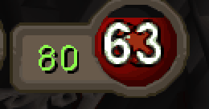

# HP & Prayer Regen Timers

Tick countdowns for your hitpoints and prayer regeneration.

*Hitpoints regen timer (in ticks) placed on the hitpoints orb with Transparent Infobox.*

## Hitpoints Regen Timer
- Counts down to your next hitpoint: 100 ticks, or 50 ticks with Rapid Heal.
- Toggling Rapid Heal resets the timer (same timing as RuneLite's Regeneration Meter).
- When overhealed it counts down to the next 1 HP decay instead, in a separate color. Useful for flicking Rapid Heal to keep overheal.
- Can keep showing at full HP (on by default).

## Prayer Regen Timer
- Prayer doesn't regenerate on its own, so this only shows while a Prayer regeneration potion is active.
- Counts down the 12 tick restore cycle and resyncs every time the potion restores a point.

## Display
- Normal infobox with the HP orb / Prayer regeneration potion icon, or
- **Transparent Infobox**: only the number. Hold Alt and drag it onto the orb.
- Ticks, Seconds or Decimals, and a configurable color for each timer.

## Credits
- **[Special Attack Timers](https://github.com/AnuVen/special-attack-timers)** by AnuVen (BSD 2-Clause): this plugin is based on its infobox/transparent overlay design, display formats and config layout.
- **Regeneration Meter** from [RuneLite](https://github.com/runelite/runelite) (BSD 2-Clause): the hitpoints regen timing (100/50 ticks, Rapid Heal reset and the login/hop offset) follows this core plugin.
- **[Prayer Regeneration Helper](https://github.com/Supalosa/prayer-regeneration-timer)** by Supalosa (BSD 2-Clause): the prayer timer resyncs on the Prayer regeneration potion varbit using the same approach.
